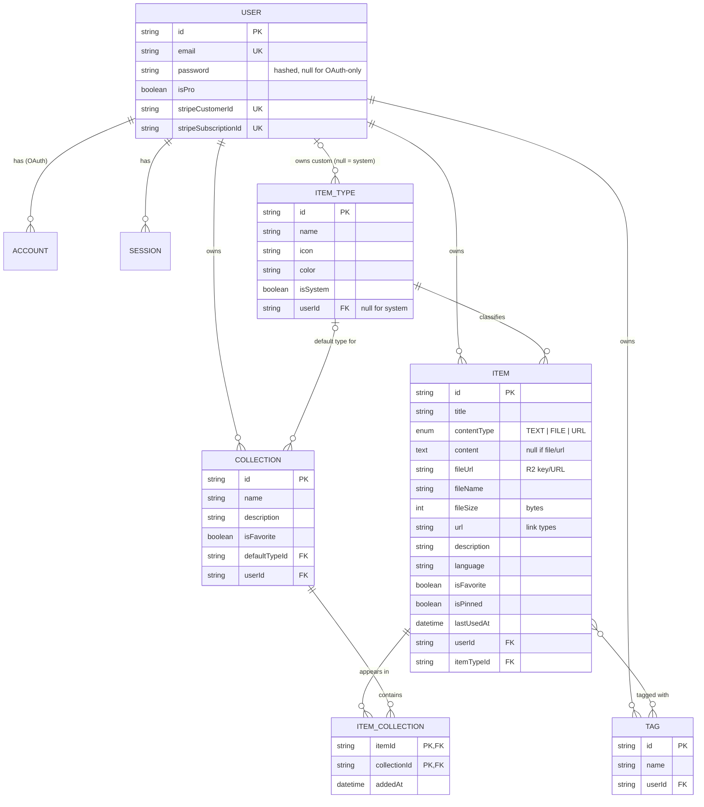
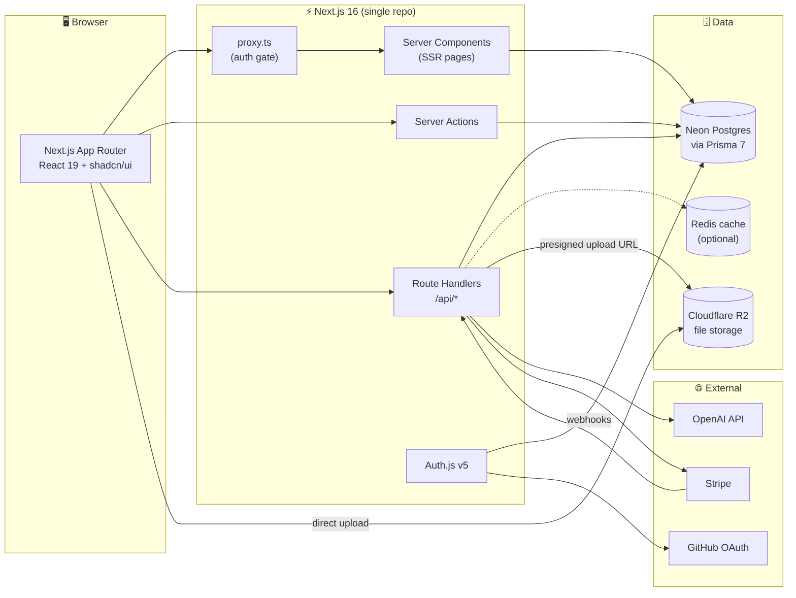
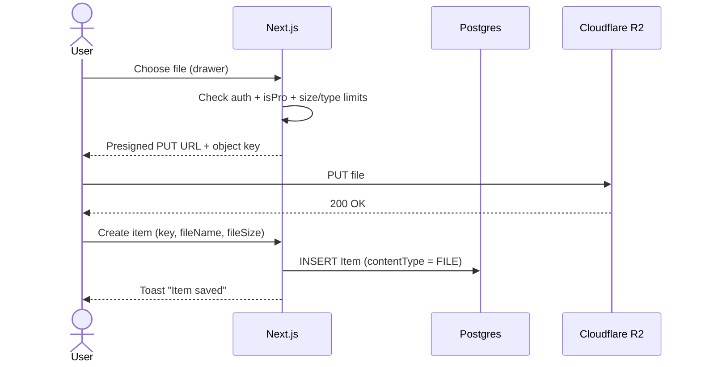
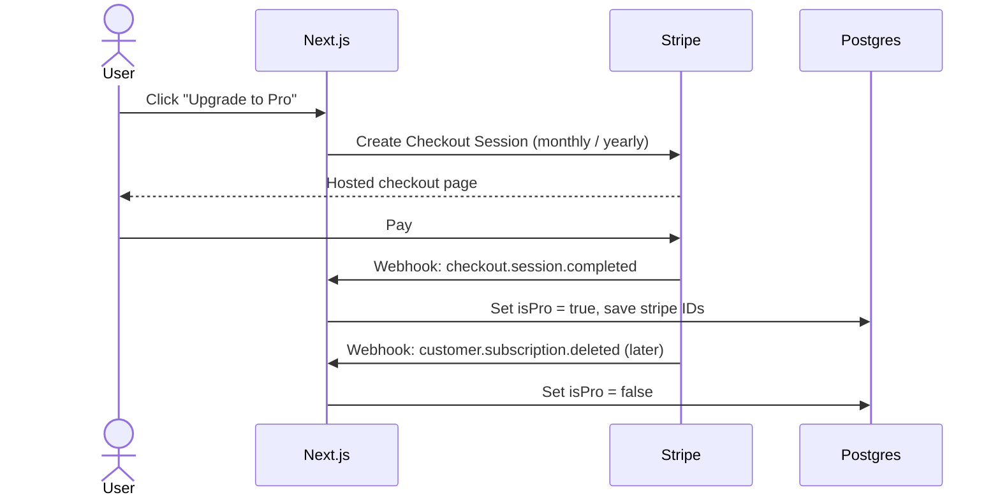

# 🗃️ DevStash — Project Overview

> **One fast, searchable, AI-enhanced hub for all your developer knowledge & resources.**

| | |
|---|---|
| **Status** | Planning / pre-development |
| **Type** | SaaS (freemium) |
| **Stack** | Next.js 16 · React 19 · TypeScript · Prisma 7 · Neon Postgres · Auth.js v5 · Cloudflare R2 · OpenAI · Tailwind v4 · shadcn/ui |
| **Last updated** | 25 Nov 2026 |

---

## 📑 Contents

1. [Problem](#-problem)
2. [Target Users](#-target-users)
3. [Features](#-features)
4. [Item Types](#-item-types)
5. [Data Model](#-data-model)
6. [Prisma Schema](#-prisma-schema)
7. [Architecture](#-architecture)
8. [Routes](#-routes)
9. [Tech Stack](#-tech-stack)
10. [Monetization](#-monetization)
11. [UI / UX](#-ui--ux)
12. [Suggested Project Structure](#-suggested-project-structure)
13. [Environment Variables](#-environment-variables)
14. [Development Rules](#-development-rules)
15. [Open Questions & Notes](#-open-questions--notes)
16. [Reference Links](#-reference-links)

---

## 🧩 Problem

Developers keep their essentials scattered across too many places:

| What | Where it usually lives |
|---|---|
| Code snippets | VS Code, Notion |
| AI prompts | Chat histories |
| Context files | Buried in projects |
| Useful links | Browser bookmarks |
| Docs | Random folders |
| Commands | `.txt` files |
| Project templates | GitHub Gists |
| Terminal commands | Bash history |

**Result:** context switching, lost knowledge, and inconsistent workflows.

**DevStash** brings all of it into **one fast, searchable, AI-enhanced hub**.

---

## 👥 Target Users

| Persona | Primary need |
|---|---|
| 🧑‍💻 **Everyday Developer** | A fast way to grab snippets, prompts, commands and links |
| 🤖 **AI-first Developer** | Saving prompts, contexts, workflows and system messages |
| 🎓 **Content Creator / Educator** | Storing code blocks, explanations and course notes |
| 🏗️ **Full-stack Builder** | Collecting patterns, boilerplates and API examples |

---

## ✨ Features

### A. Items & Item Types

- Every item has a **type**.
- DevStash ships with **7 system types** that cannot be edited or deleted (see [Item Types](#-item-types)).
- Users will later be able to create **custom types** (Pro, post-launch).
- Each type stores its content in one of three ways:
  - **Text**: snippet, prompt, note, command
  - **URL**: link
  - **File**: file, image (Pro only)
- Type listing URLs use the plural slug, e.g. `/items/snippets`, `/items/prompts`.
- Items are **created and opened in a drawer** so they're quick to reach without leaving the current page.

### B. Collections

- Users group items into **collections**, which can hold items of **any type**.
- An item can belong to **many collections** (many-to-many), e.g. a React snippet can sit in both *React Patterns* and *Interview Prep*.

Examples:

| Collection | Typical contents |
|---|---|
| React Patterns | snippets, notes |
| Context Files | files |
| Python Snippets | snippets |

### C. Search

Powerful search across:

- Titles
- Content
- Tags
- Types

### D. Authentication

- Email + password
- GitHub OAuth

### E. Other Features

- ⭐ Favorite collections and items
- 📌 Pin items to the top
- 🕒 Recently used items
- 📥 Import code from a file
- 📝 Markdown editor for text types
- 📤 File upload for file types (file / image)
- 📦 Export data in different formats (JSON / ZIP)
- 🌙 Dark mode by default
- ➕ Add / remove items to / from multiple collections
- 🔗 See which collections an item belongs to

### F. AI Features (Pro only)

| Feature | Description |
|---|---|
| 🏷️ Auto-tag suggestions | Suggests tags based on item content |
| 📄 AI summaries | Short summary of long notes, files or snippets |
| 💡 Explain this code | Plain-English explanation of a snippet |
| ✨ Prompt optimizer | Rewrites prompts to be clearer and more effective |

---

## 🎨 Item Types

System types are seeded into the database with `isSystem = true` and `userId = null`. Icons are from [Lucide](https://lucide.dev/icons/), which is the icon set shadcn/ui uses.

| Type | Slug / URL | Storage | Color | Icon | Tier |
|---|---|---|---|---|---|
| Snippet | `/items/snippets` | text |  `#3b82f6` blue | [`Code`](https://lucide.dev/icons/code) | Free |
| Prompt | `/items/prompts` | text |  `#8b5cf6` purple | [`Sparkles`](https://lucide.dev/icons/sparkles) | Free |
| Command | `/items/commands` | text |  `#f97316` orange | [`Terminal`](https://lucide.dev/icons/terminal) | Free |
| Note | `/items/notes` | text |  `#fde047` yellow | [`StickyNote`](https://lucide.dev/icons/sticky-note) | Free |
| Link | `/items/links` | url |  `#10b981` emerald | [`Link`](https://lucide.dev/icons/link) | Free |
| File | `/items/files` | file |  `#6b7280` gray | [`File`](https://lucide.dev/icons/file) | **Pro** |
| Image | `/items/images` | file |  `#ec4899` pink | [`Image`](https://lucide.dev/icons/image) | **Pro** |

Suggested constant for the app (keeps UI, seed data and routing in sync):

```ts
// src/lib/item-types.ts
export const SYSTEM_ITEM_TYPES = [
  { name: "snippet", slug: "snippets", contentType: "TEXT", color: "#3b82f6", icon: "Code",       pro: false },
  { name: "prompt",  slug: "prompts",  contentType: "TEXT", color: "#8b5cf6", icon: "Sparkles",   pro: false },
  { name: "command", slug: "commands", contentType: "TEXT", color: "#f97316", icon: "Terminal",   pro: false },
  { name: "note",    slug: "notes",    contentType: "TEXT", color: "#fde047", icon: "StickyNote", pro: false },
  { name: "link",    slug: "links",    contentType: "URL",  color: "#10b981", icon: "Link",       pro: false },
  { name: "file",    slug: "files",    contentType: "FILE", color: "#6b7280", icon: "File",       pro: true  },
  { name: "image",   slug: "images",   contentType: "FILE", color: "#ec4899", icon: "Image",      pro: true  },
] as const;
```

---

## 🗄️ Data Model

### Entity relationship diagram



### Key modelling decisions

| Decision | Choice | Why |
|---|---|---|
| ID format | `cuid()` | URL-friendly; matches the Auth.js Prisma adapter models |
| Content type | `TEXT \| FILE \| URL` enum | Matches the three storage modes of the item types |
| Tags | **Per-user**, unique on `(userId, name)` | Keeps each user's data isolated |
| Item ↔ Tag | Implicit many-to-many | No extra data on the relation |
| Item ↔ Collection | Explicit join table `ItemCollection` | Needs `addedAt` |
| System types | `ItemType.userId = null`, `isSystem = true` | One table for system and future custom types |
| Recently used | `Item.lastUsedAt` *(added)* | Spec lists "Recently used" but no field supported it |
| Files | Store the **R2 object key** (and derive the URL) | Lets you change bucket domain / use signed URLs later |

---

## 🧬 Prisma Schema

Written for **Prisma 7** (new `prisma-client` generator, required `output` path, connection URL in `prisma.config.ts`, driver adapter in app code). Auth models follow the Auth.js Prisma adapter.

### `prisma/schema.prisma`

```prisma
generator client {
  provider = "prisma-client"
  output   = "../src/generated/prisma"
}

datasource db {
  provider = "postgresql"
  // Prisma 7: no `url` here — it lives in prisma.config.ts
}

// ─────────────────────────────────────────────
// Enums
// ─────────────────────────────────────────────

enum ContentType {
  TEXT
  FILE
  URL
}

// ─────────────────────────────────────────────
// Auth (Auth.js / NextAuth v5 + app fields)
// ─────────────────────────────────────────────

model User {
  id            String    @id @default(cuid())
  name          String?
  email         String?   @unique
  emailVerified DateTime?
  image         String?
  password      String? // hashed (bcrypt/argon2); null for OAuth-only users

  // Billing
  isPro                Boolean @default(false)
  stripeCustomerId     String? @unique
  stripeSubscriptionId String? @unique

  createdAt DateTime @default(now())
  updatedAt DateTime @updatedAt

  accounts    Account[]
  sessions    Session[]
  items       Item[]
  itemTypes   ItemType[]
  collections Collection[]
  tags        Tag[]
}

model Account {
  id                String  @id @default(cuid())
  userId            String
  type              String
  provider          String
  providerAccountId String
  refresh_token     String? @db.Text
  access_token      String? @db.Text
  expires_at        Int?
  token_type        String?
  scope             String?
  id_token          String? @db.Text
  session_state     String?

  user User @relation(fields: [userId], references: [id], onDelete: Cascade)

  @@unique([provider, providerAccountId])
  @@index([userId])
}

model Session {
  id           String   @id @default(cuid())
  sessionToken String   @unique
  userId       String
  expires      DateTime

  user User @relation(fields: [userId], references: [id], onDelete: Cascade)

  @@index([userId])
}

model VerificationToken {
  identifier String
  token      String   @unique
  expires    DateTime

  @@unique([identifier, token])
}

// ─────────────────────────────────────────────
// Core domain
// ─────────────────────────────────────────────

model ItemType {
  id       String  @id @default(cuid())
  name     String // "snippet", "prompt", ...
  icon     String // Lucide icon name, e.g. "Code"
  color    String // hex, e.g. "#3b82f6"
  isSystem Boolean @default(false)

  userId String? // null = system type
  user   User?   @relation(fields: [userId], references: [id], onDelete: Cascade)

  items                 Item[]
  defaultForCollections Collection[]

  createdAt DateTime @default(now())
  updatedAt DateTime @updatedAt

  // Note: Postgres treats NULLs as distinct, so this does not stop duplicate
  // *system* type names — the seed script must be idempotent (upsert).
  @@unique([userId, name])
}

model Item {
  id          String      @id @default(cuid())
  title       String
  contentType ContentType

  content String? @db.Text // text types; null for file/url

  // File types (Pro)
  fileUrl  String? // R2 object key or URL
  fileName String? // original filename
  fileSize Int? // bytes

  // Link type
  url String?

  description String?
  language    String? // optional, for code highlighting
  isFavorite  Boolean   @default(false)
  isPinned    Boolean   @default(false)
  lastUsedAt  DateTime? // powers "Recently used"

  userId String
  user   User   @relation(fields: [userId], references: [id], onDelete: Cascade)

  itemTypeId String
  itemType   ItemType @relation(fields: [itemTypeId], references: [id], onDelete: Restrict)

  tags        Tag[]
  collections ItemCollection[]

  createdAt DateTime @default(now())
  updatedAt DateTime @updatedAt

  @@index([userId, itemTypeId])
  @@index([userId, isPinned])
  @@index([userId, isFavorite])
  @@index([userId, lastUsedAt])
}

model Collection {
  id          String  @id @default(cuid())
  name        String
  description String?
  isFavorite  Boolean @default(false)

  // Default type for new items added to an empty collection
  defaultTypeId String?
  defaultType   ItemType? @relation(fields: [defaultTypeId], references: [id], onDelete: SetNull)

  userId String
  user   User   @relation(fields: [userId], references: [id], onDelete: Cascade)

  items ItemCollection[]

  createdAt DateTime @default(now())
  updatedAt DateTime @updatedAt

  @@index([userId])
  @@index([userId, isFavorite])
}

model ItemCollection {
  itemId       String
  collectionId String
  addedAt      DateTime @default(now())

  item       Item       @relation(fields: [itemId], references: [id], onDelete: Cascade)
  collection Collection @relation(fields: [collectionId], references: [id], onDelete: Cascade)

  @@id([itemId, collectionId])
  @@index([collectionId])
}

model Tag {
  id   String @id @default(cuid())
  name String

  userId String
  user   User   @relation(fields: [userId], references: [id], onDelete: Cascade)

  items Item[]

  @@unique([userId, name])
}
```

### `prisma.config.ts`

```ts
import "dotenv/config";
import { defineConfig, env } from "prisma/config";

export default defineConfig({
  schema: "prisma/schema.prisma",
  migrations: {
    path: "prisma/migrations",
    seed: "tsx prisma/seed.ts",
  },
  datasource: {
    // CLI / migrations use the direct (unpooled) Neon connection
    url: env("DATABASE_URL_UNPOOLED"),
  },
});
```

### `src/lib/db.ts`

```ts
import { PrismaClient } from "@/generated/prisma/client";
import { PrismaNeon } from "@prisma/adapter-neon";

const globalForPrisma = globalThis as unknown as { prisma?: PrismaClient };

function createClient() {
  // App runtime uses the pooled Neon connection
  const adapter = new PrismaNeon({ connectionString: process.env.DATABASE_URL! });
  return new PrismaClient({ adapter });
}

export const prisma = globalForPrisma.prisma ?? createClient();

if (process.env.NODE_ENV !== "production") globalForPrisma.prisma = prisma;
```

### Seed (outline)

`prisma/seed.ts` should **upsert** the 7 system item types from `SYSTEM_ITEM_TYPES` so it can run safely in dev and prod.

---

## 🏛️ Architecture



### File upload flow (Pro)

Uploading straight from the browser to R2 with a presigned URL keeps large files off your Next.js server.



### Pro upgrade flow



---

## 🧭 Routes

### Pages

| Route | Purpose |
|---|---|
| `/` | Marketing / landing page |
| `/login`, `/register` | Auth |
| `/dashboard` | Collection grid + pinned / recent items |
| `/items/[type]` | All items of a type, e.g. `/items/snippets` |
| `/collections` | All collections |
| `/collections/[id]` | Items in a collection |
| `/favorites` | Favorite items and collections |
| `/search?q=` | Search results |
| `/settings` | Profile, billing, export, theme |

Items open in a **drawer** over the current page. Optionally make the drawer addressable (e.g. `?item=<id>`) so items are linkable.

### API route handlers

| Method | Route | Purpose |
|---|---|---|
| `*` | `/api/auth/[...nextauth]` | Auth.js handlers |
| `GET/POST` | `/api/items` | List / create items |
| `GET/PATCH/DELETE` | `/api/items/[id]` | Read / update / delete item |
| `POST` | `/api/uploads/presign` | Get R2 presigned upload URL (Pro) |
| `GET/POST` | `/api/collections` | List / create collections |
| `PATCH/DELETE` | `/api/collections/[id]` | Update / delete collection |
| `GET` | `/api/search` | Search |
| `POST` | `/api/ai/tags` | AI tag suggestions (Pro) |
| `POST` | `/api/ai/summary` | AI summary (Pro) |
| `POST` | `/api/ai/explain` | Explain code (Pro) |
| `POST` | `/api/ai/optimize-prompt` | Prompt optimizer (Pro) |
| `GET` | `/api/export` | Export JSON / ZIP (Pro) |
| `POST` | `/api/stripe/checkout` | Create checkout session |
| `POST` | `/api/stripe/webhook` | Stripe webhooks |

> Simple mutations (favorite, pin, add to collection) can be **Server Actions** instead of API routes.

---

## 🛠️ Tech Stack

| Layer | Choice | Notes |
|---|---|---|
| Framework | **Next.js 16** (App Router) | SSR pages with dynamic client components; one repo |
| UI library | **React 19** | |
| Language | **TypeScript** | |
| Request gate | `proxy.ts` | Next.js 16 renamed `middleware.ts` → `proxy.ts` |
| Database | **Neon** (serverless Postgres) | Pooled URL for app, unpooled for migrations |
| ORM | **Prisma 7** | `prisma-client` generator + `@prisma/adapter-neon` |
| Cache | Redis *(maybe)* | e.g. Upstash; only add if needed |
| File storage | **Cloudflare R2** | S3-compatible; presigned uploads |
| Auth | **Auth.js (NextAuth v5)** | Email/password (Credentials) + GitHub OAuth |
| AI | **OpenAI `gpt-5-nano`** | Tagging, summaries, code explanation, prompt optimizer |
| Payments | **Stripe** | Checkout + webhooks |
| Styling | **Tailwind CSS v4** | |
| Components | **shadcn/ui** | Lucide icons, Sheet/Drawer, Sonner toasts, Skeleton |
| Editor | Markdown editor *(TBD)* | e.g. CodeMirror / Monaco / a Markdown editor component |
| Syntax highlighting | *(TBD)* | e.g. Shiki |

---

## 💳 Monetization

Freemium model.

| Feature | Free | Pro |
|---|:---:|:---:|
| **Price** | £0 / $0 | **$8 / month** or **$72 / year** (25% off) |
| Items | 50 total | Unlimited |
| Collections | 3 | Unlimited |
| System types (snippet, prompt, note, command, link) | ✅ | ✅ |
| File & image uploads | ❌ | ✅ |
| Custom types *(later)* | ❌ | ✅ |
| Search | Basic | ✅ |
| AI auto-tagging | ❌ | ✅ |
| AI summaries | ❌ | ✅ |
| AI code explanation | ❌ | ✅ |
| AI prompt optimizer | ❌ | ✅ |
| Export (JSON / ZIP) | ❌ | ✅ |
| Priority support | ❌ | ✅ |

### Implementation notes

- Put **all limits in one place**, e.g. `src/lib/plans.ts`, and check them **on the server** (Server Actions / API routes), never only in the UI.
- **During development, all users get everything.** Use a single flag so this is one switch to flip at launch:

```ts
// src/lib/plans.ts
export const ENFORCE_PLAN_LIMITS = process.env.ENFORCE_PLAN_LIMITS === "true";

export const FREE_LIMITS = { items: 50, collections: 3 } as const;

export function canUsePro(user: { isPro: boolean }) {
  return !ENFORCE_PLAN_LIMITS || user.isPro;
}
```

---

## 🖌️ UI / UX

### General

- Modern, minimal, developer-focused
- **Dark mode by default**, light mode optional
- Clean typography, generous whitespace
- Subtle borders and shadows
- Syntax highlighting for code blocks
- Inspiration: [Notion](https://www.notion.so), [Linear](https://linear.app), [Raycast](https://www.raycast.com)

### Layout

```
┌──────────────┬──────────────────────────────────────────────┐
│  SIDEBAR     │  🔍 Search…                        [+ New]   │
│  (collapse)  ├──────────────────────────────────────────────┤
│              │  Collections                                 │
│  Types       │  ┌──────────┐ ┌──────────┐ ┌──────────┐      │
│  </> Snippets│  │ React    │ │ Prompts  │ │ Python   │      │
│  ✨ Prompts  │  │ Patterns │ │ Library  │ │ Snippets │      │
│  >_ Commands │  │ (blue bg)│ │(purple)  │ │ (blue bg)│      │
│  🗒 Notes    │  └──────────┘ └──────────┘ └──────────┘      │
│  🔗 Links    │                                              │
│  📄 Files    │  Pinned / Recent items                       │
│  🖼 Images   │  ┌─────────┐ ┌─────────┐ ┌─────────┐         │
│              │  │▌snippet │ │▌prompt  │ │▌command │  ──►  Drawer
│  Collections │  │ (blue   │ │(purple  │ │(orange  │     opens on
│  • React…    │  │  border)│ │ border) │ │ border) │     click
│  • Python…   │  └─────────┘ └─────────┘ └─────────┘         │
└──────────────┴──────────────────────────────────────────────┘
```

- **Sidebar:** item types (linking to `/items/[type]`) and latest collections. Collapsible on desktop; becomes a drawer on mobile.
- **Main:** grid of collection cards. Each card's **background colour** comes from the type it holds most of.
- **Item cards:** colour-coded **border** by type.
- **Items open in a drawer** for quick viewing and editing.

### Responsive

- Desktop-first, but usable on mobile
- Sidebar → drawer on mobile

### Micro-interactions

- Smooth transitions
- Hover states on cards
- Toast notifications for actions
- Loading skeletons

---

## 📁 Suggested Project Structure

```
devstash/
├── prisma/
│   ├── schema.prisma
│   ├── migrations/
│   └── seed.ts
├── prisma.config.ts
├── src/
│   ├── app/
│   │   ├── (marketing)/page.tsx
│   │   ├── (auth)/login/page.tsx
│   │   ├── (auth)/register/page.tsx
│   │   ├── (app)/layout.tsx          # sidebar + main shell
│   │   ├── (app)/dashboard/page.tsx
│   │   ├── (app)/items/[type]/page.tsx
│   │   ├── (app)/collections/page.tsx
│   │   ├── (app)/collections/[id]/page.tsx
│   │   ├── (app)/favorites/page.tsx
│   │   ├── (app)/search/page.tsx
│   │   ├── (app)/settings/page.tsx
│   │   └── api/…                     # route handlers (see Routes)
│   ├── components/
│   │   ├── ui/                       # shadcn/ui
│   │   ├── items/                    # ItemCard, ItemDrawer, ItemForm
│   │   ├── collections/
│   │   └── layout/                   # Sidebar, Topbar
│   ├── lib/
│   │   ├── db.ts                     # Prisma client
│   │   ├── item-types.ts             # system type constants
│   │   ├── plans.ts                  # free/pro limits
│   │   ├── r2.ts
│   │   ├── openai.ts
│   │   └── stripe.ts
│   ├── actions/                      # server actions
│   ├── generated/prisma/             # Prisma 7 output (git-ignored)
│   └── auth.ts                       # Auth.js config
├── proxy.ts                          # Next.js 16 (was middleware.ts)
└── .env
```

---

## 🔐 Environment Variables

```bash
# Database (Neon)
DATABASE_URL=                 # pooled — used by the app
DATABASE_URL_UNPOOLED=        # direct — used by Prisma CLI / migrations

# Auth.js
AUTH_SECRET=
AUTH_GITHUB_ID=
AUTH_GITHUB_SECRET=

# Cloudflare R2
R2_ACCOUNT_ID=
R2_ACCESS_KEY_ID=
R2_SECRET_ACCESS_KEY=
R2_BUCKET_NAME=
R2_PUBLIC_URL=                # optional, if using a public bucket / custom domain

# OpenAI
OPENAI_API_KEY=

# Stripe
STRIPE_SECRET_KEY=
STRIPE_WEBHOOK_SECRET=
STRIPE_PRICE_ID_MONTHLY=
STRIPE_PRICE_ID_YEARLY=
NEXT_PUBLIC_STRIPE_PUBLISHABLE_KEY=

# Feature flags
ENFORCE_PLAN_LIMITS=false     # true at launch

# Optional
REDIS_URL=
```

---

## 📏 Development Rules

> ⚠️ **NEVER use `prisma db push` or change the database structure directly.**
> All schema changes go through migrations.

| Environment | Command |
|---|---|
| Development | `npx prisma migrate dev --name <change_name>` |
| Production | `npx prisma migrate deploy` |
| Generate client | `npx prisma generate` |
| Seed | `npx prisma db seed` |

Other conventions:

- Always check `userId` ownership on every read and write.
- Enforce plan limits on the server.
- Keep the generated Prisma client out of git (`src/generated/`).
- Fetch the latest Prisma 7 docs before schema work, as the spec requests.

---

## ❓ Open Questions & Notes

Things I noticed while cleaning up the spec. None are decided; they're here so they don't get lost.

### Stack

1. **Auth.js maintenance status.** Auth.js (NextAuth) is now maintained by the Better Auth team, which recommends Better Auth for new projects. NextAuth v5 is still labelled beta. Worth deciding before building auth: stay on Auth.js v5, or start on Better Auth?
2. **Credentials + sessions.** With Auth.js, the Credentials (email/password) provider works with **JWT sessions**, not database sessions. If you stay on Auth.js, plan for `session: { strategy: "jwt" }`. The `Session` model is then mostly unused, but harmless to keep.
3. **Prisma version.** The spec says "Prisma 7 latest". Prisma's docs now advertise **Prisma ORM 8**. Stay on 7 deliberately, or move to 8?
4. **AI model.** OpenAI's model page for `gpt-5-nano` now suggests newer models for new speed/cost-sensitive work. `gpt-5-nano` still works; worth comparing before launch.
5. **Redis.** Marked "maybe". Suggest leaving it out until there's a measured need.

### Product

6. **AI Summaries** are listed under AI Features but missing from the Pro feature list. Added to the Pro column above; confirm.
7. **Export** is listed as a general feature but also as Pro-only. Treated as **Pro-only** above; confirm.
8. **"Basic search" vs full search.** What's the difference between Free and Pro search? (e.g. Free = titles/tags, Pro = full content / fuzzy.)
9. **Search implementation.** Postgres full-text search (`tsvector`) or `pg_trgm` for fuzzy matching would avoid a separate search service. This needs a migration with raw SQL.
10. **Free-tier downgrade.** What happens when a Pro user with 200 items cancels? (Suggest: read-only above the limit, no deletion.)
11. **Upload limits.** Max file size and allowed MIME types for files/images aren't defined.
12. **Collection colour.** "Background colour based on the type it holds most of": what about ties and empty collections? (Suggest: fall back to `defaultTypeId`, then neutral.)
13. **Tags per user.** Is there a tag limit for free users?
14. **Note colour contrast.** `#fde047` (yellow) works on dark backgrounds but is hard to read as text on light mode. May need a darker variant for light mode.

### Spec clean-up done

- Fixed typo "GitHu gists" → "GitHub Gists".
- Added `URL` to `contentType` so links have their own storage mode.
- Added `lastUsedAt` to Item to support "Recently used".
- Added `userId` to Tag (per-user tags).
- Added `password` to User for email/password sign-in.
- Added `createdAt` / `updatedAt` to User and ItemType.
- Added standard Auth.js models (`Account`, `Session`, `VerificationToken`).

---

## 🔗 Reference Links

### Framework
- [Next.js docs](https://nextjs.org/docs)
- [Next.js 16 — Proxy (formerly Middleware)](https://nextjs.org/docs/app/getting-started/proxy)
- [React docs](https://react.dev)

### Database
- [Prisma ORM v7 docs](https://www.prisma.io/docs/orm/v7)
- [Upgrade to Prisma 7](https://www.prisma.io/docs/guides/upgrade-prisma-orm/v7)
- [Prisma Config reference (`prisma.config.ts`)](https://www.prisma.io/docs/orm/v7/reference/prisma-config-reference)
- [Prisma Migrate](https://www.prisma.io/docs/orm/prisma-migrate)
- [Neon + Prisma guide](https://neon.com/docs/guides/prisma)

### Auth
- [Auth.js](https://authjs.dev)
- [Auth.js Prisma adapter](https://authjs.dev/getting-started/adapters/prisma)
- [Auth.js joins Better Auth (announcement)](https://better-auth.com/blog/authjs-joins-better-auth)
- [Better Auth docs](https://www.better-auth.com/docs)

### Storage, AI, payments
- [Cloudflare R2 docs](https://developers.cloudflare.com/r2/)
- [R2 presigned URLs](https://developers.cloudflare.com/r2/api/s3/presigned-urls/)
- [OpenAI — GPT-5 nano](https://developers.openai.com/docs/models/gpt-5-nano)
- [Stripe Checkout](https://docs.stripe.com/payments/checkout)
- [Stripe subscriptions webhooks](https://docs.stripe.com/billing/subscriptions/webhooks)

### UI
- [Tailwind CSS v4](https://tailwindcss.com/docs)
- [shadcn/ui](https://ui.shadcn.com)
- [shadcn/ui + Tailwind v4](https://ui.shadcn.com/docs/tailwind-v4)
- [Lucide icons](https://lucide.dev/icons/)
- [Shiki (syntax highlighting)](https://shiki.style)
